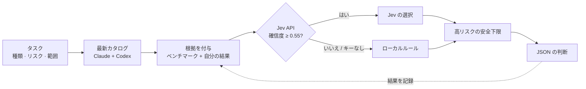

<div align="center">

# 🧭 jev-model-router

**どの AI モデルを使うか、もう迷わない。タスクごとに最適な Claude / Codex モデルと推論レベルを選びます。**

[English](README.md) · [한국어](README.ko.md) · [日本語](README.ja.md) · [简体中文](README.zh-CN.md)

[](https://www.python.org/)
[](LICENSE)
[](#-クイックスタート)
[](#-テスト)
[](https://platform.claude.com/docs/en/models/overview)
[](https://developers.openai.com/api/docs/models)

</div>

---

コーディングエージェントはサブエージェントに作業を任せられます。では、*どの*モデルに、*どれだけ*深く考えさせるべきでしょうか。毎回最大のモデルを使えばトークンを浪費し、最小のモデルを使えばバグが出ます。

**jev-model-router** はこの問いにコマンド 1 行で答えます。最新のモデル一覧を読み込み、公式ベンチマークと**あなた自身の過去の結果**を比較し、エージェントがそのまま使える JSON の判断を 1 つ出力します。

```bash
python3 jev_model_router.py --task "add unit tests for the parser" --kind code --risk medium
```

```jsonc
// 出力例（一部省略）
{
  "provider": "claude",
  "model": "sonnet",
  "effort": "medium",
  "model_source": "jev",
  "model_facts": { "api_model_id": "claude-sonnet-5-5", "api_price": "$2 / input MTok, $10 / output MTok" },
  "evidence": { "basis": "jev_with_evidence", "internal_count": 0 }
}
```

## ✨ 特長

- 🔄 **常に最新。** 公式 Claude モデル一覧と、*あなたのアカウント*で実際に使える Codex モデルを取得します。古くなるハードコードの表はありません。
- 🧠 **モデルと推論レベルを別々に選択。** 推論の深さ（`low` → `ultra`）はブランドではなくタスクで決めます。
- 📊 **誠実な根拠。** 全候補が同じテスト・バージョン・推論レベルを持つ場合のみベンチマークで順位付けします。自分の結果は比較可能な 5 件以上から反映します。データがないことは「不明」であり「低性能」ではありません。
- 🛡️ **安全下限。** 高リスクのタスクには、必要な能力未満のモデルや `high` 未満の推論を割り当てません。
- 🔍 **クロスレビュー。** `--reviewer-of claude` で Codex にレビューを任せます（逆も可）。
- 📴 **オフラインでも動作。** API キーがない、またはネットワーク障害時は決定的なローカルルールで選びます。
- 🔒 **プライバシー保護。** 認証情報やメールアドレスに見えるテキストは拒否します。結果ファイルは `0600` で書き込みます。
- 📦 **依存関係ゼロ。** Python 標準ライブラリのみ。ファイル 2 つです。

## 🚀 クイックスタート

```bash
git clone https://github.com/mcpysup-netizen/jev-model-router.git
cd jev-model-router

# ローカルルールですぐ動作
python3 jev_model_router.py --task "refactor the auth module" --kind code --risk high --fallback-only

# 任意: API による選択を有効化
export TYPESAFE_API_KEY="your-key"
python3 jev_model_router.py --task "refactor the auth module" --kind code --risk high
```

## ⚙️ 仕組み



ポイントはこのループです。**結果を記録するほど、一般的なベンチマークではなく、あなたの作業に合わせてルーターが賢くなります。**

## 📖 使い方

| オプション | 内容 |
|---|---|
| `--task` | 短く機密情報を含まない要約（最大 500 文字） |
| `--kind` | `scan` `mechanical` `writing` `research` `code` `review` `architecture` `coordination` |
| `--risk` | `low` `medium` `high` |
| `--scope` | `small` `medium` `large`（既定 `medium`） |
| `--priority` | `balanced` `speed` `cost` `quality`（既定 `balanced`） |
| `--provider` | `claude` または `codex` に限定 |
| `--reviewer-of` | レビュー時に*別の*プロバイダーを強制 |
| `--user-model` / `--user-effort` | ユーザー指定が常に優先 |
| `--fallback-only` | API を使わずローカルルールのみ |
| `--list-models` | 現在の候補を表示 |

### ループを閉じる: 結果の記録

```bash
python3 jev_model_router.py record --task "parser tests" --kind code --risk medium \
  --scope medium --model claude-sonnet-5-5 --effort medium --verdict pass --minutes 12
```

判定: `pass`、`pass_with_fixes`、`fail`。任意: `--minutes`、`--cost-usd`、`--rework`、`--note`。

### ベンチマークの更新

```bash
python3 jev_model_router.py refresh-benchmarks
```

## 🔧 設定

| 項目 | 場所 |
|---|---|
| Jev API キー | 環境変数 `TYPESAFE_API_KEY` または `~/.config/typesafe/api_key` |
| データフォルダー | 環境変数 `JEV_DATA_DIR`、既定 `~/.local/share/jev-model-router` |
| カタログキャッシュ | `~/.cache/jev-model-router` |
| 複数の Codex アカウント | `~/.config/ai-accounts/accounts.json`（[例](examples/accounts.example.json)）、`--codex-account` または `AI_CODEX_ACCOUNT` で選択 |

## 🤖 エージェントから使う

`CLAUDE.md` または `AGENTS.md` に 1 行追加します。

```markdown
サブエージェントに委任する前に `python3 path/to/jev_model_router.py --task "<1行の要約>" --kind <kind> --risk <risk>` を実行し、
返された `model`（と `effort`）を呼び出しに渡す。
```

## 🔒 プライバシー

- `--task` と `--note` は API に送信され、ローカルの結果ファイルに保存されます。短く、秘密情報なしで書いてください。
- キー、`accounts.json`、結果ファイルはコミットしないでください。`.gitignore` で除外済みです。
- ベンチマーク値はローカルキャッシュにのみ保存されます。このリポジトリは第三者データを再配布しません。

## 🧪 テスト

```bash
python3 -m unittest discover -s tests
```

## ❓ よくある質問

**API キーは必須ですか？** いいえ。キーがなくてもローカルルールで有効な結果を返します。

**一部のメッセージが韓国語なのはなぜですか？** もともと韓国語のワークフロー向けに作られたためです。JSON のキーは英語です。

**モデルを直接呼び出しますか？** いいえ。選ぶだけです。呼び出しはエージェントが行います。

## 📄 ライセンス

[MIT](LICENSE)

<div align="center">

トークンの節約に役立ったら、⭐ で他の人にも届けてください。

</div>
