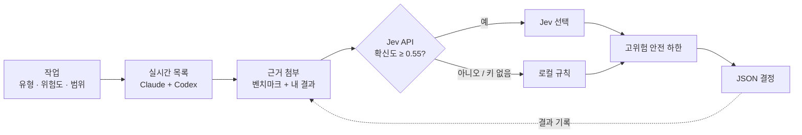

<div align="center">


**어떤 AI 모델을 쓸지 더 이상 고민하지 마세요. 작업마다 맞는 Claude·Codex 모델과 추론 수준을 골라 줍니다.**

[English](README.md) · [한국어](README.ko.md) · [日本語](README.ja.md) · [简体中文](README.zh-CN.md)

[](https://www.python.org/)
[](LICENSE)
[](#-빠른-시작)
[](#-테스트)
[](https://platform.claude.com/docs/en/models/overview)
[](https://developers.openai.com/api/docs/models)

</div>

---

코딩 에이전트는 일을 서브에이전트에 맡길 수 있습니다. 그런데 *어떤* 모델에, *얼마나* 깊게 생각시켜야 할까요? 매번 가장 큰 모델을 쓰면 토큰이 낭비됩니다. 가장 작은 모델을 쓰면 버그가 나갑니다.

**jev-model-router**는 이 질문에 명령 한 줄로 답합니다. 실시간 모델 목록을 읽고, 공식 벤치마크와 **내 과거 작업 결과**를 함께 따져, 에이전트가 바로 쓸 수 있는 JSON 결정 하나를 출력합니다.

```bash
python3 jev_model_router.py --task "add unit tests for the parser" --kind code --risk medium
```

```jsonc
// 출력 예시 (일부 생략)
{
  "provider": "claude",
  "model": "sonnet",
  "effort": "medium",
  "model_source": "jev",
  "model_facts": { "api_model_id": "claude-sonnet-5-5", "api_price": "$2 / input MTok, $10 / output MTok" },
  "evidence": { "basis": "jev_with_evidence", "internal_count": 0 }
}
```

## ✨ 특징

- 🔄 **항상 최신.** 공식 Claude 모델 목록과 *내 계정*에서 실제로 쓸 수 있는 Codex 모델을 읽어 옵니다. 낡아 버리는 하드코딩 모델 표가 없습니다.
- 🧠 **모델과 추론 수준을 따로 고름.** 추론 깊이(`low` → `ultra`)는 모델 브랜드와 무관하게 작업 기준으로 정합니다.
- 📊 **정직한 근거.** 모든 후보가 같은 시험·버전·추론 수준을 가질 때만 벤치마크로 순위를 매깁니다. 내 결과는 비교 가능한 5건 이상부터 반영합니다. 자료가 없으면 *모름*이지 *나쁨*이 아닙니다.
- 🛡️ **안전 하한.** 위험도 높은 작업에는 필요 역량 미만 모델이나 `high` 미만 추론을 주지 않습니다.
- 🔍 **교차 검수.** `--reviewer-of claude`를 주면 검수는 Codex가 맡습니다(반대도 가능).
- 📴 **오프라인 동작.** API 키가 없거나 네트워크가 실패하면 정해진 로컬 규칙으로 고릅니다.
- 🔒 **개인정보 보호.** 비밀번호·키·이메일처럼 보이는 작업 설명은 거부합니다. 결과 파일은 `0600` 권한으로 씁니다.
- 📦 **의존성 0.** 파이썬 표준 라이브러리만 씁니다. 파일 두 개입니다.

## 🚀 빠른 시작

```bash
git clone https://github.com/mcpysup-netizen/jev-model-router.git
cd jev-model-router

# 로컬 규칙으로 바로 동작
python3 jev_model_router.py --task "refactor the auth module" --kind code --risk high --fallback-only

# 선택: API 기반 선택 켜기
export TYPESAFE_API_KEY="your-key"
python3 jev_model_router.py --task "refactor the auth module" --kind code --risk high
```

## ⚙️ 동작 방식



핵심은 이 순환입니다. **작업 결과를 기록할수록, 일반 벤치마크가 아니라 내 작업에 맞게 라우터가 좋아집니다.**

## 📖 사용법

| 옵션 | 하는 일 |
|---|---|
| `--task` | 짧고 민감정보 없는 작업 요약(최대 500자) |
| `--kind` | `scan` `mechanical` `writing` `research` `code` `review` `architecture` `coordination` |
| `--risk` | `low` `medium` `high` |
| `--scope` | `small` `medium` `large` (기본 `medium`) |
| `--priority` | `balanced` `speed` `cost` `quality` (기본 `balanced`) |
| `--provider` | `claude` 또는 `codex`로 제한 |
| `--reviewer-of` | 검수 작업에서 *다른* 제공자를 강제 |
| `--user-model` / `--user-effort` | 사용자 지정이 항상 우선 |
| `--fallback-only` | API를 건너뛰고 로컬 규칙만 사용 |
| `--list-models` | 현재 후보 보기 |

### 순환 완성: 결과 기록

```bash
python3 jev_model_router.py record --task "parser tests" --kind code --risk medium \
  --scope medium --model claude-sonnet-5-5 --effort medium --verdict pass --minutes 12
```

판정: `pass`, `pass_with_fixes`, `fail`. 선택 항목: `--minutes`, `--cost-usd`, `--rework`, `--note`.

### 벤치마크 갱신

```bash
python3 jev_model_router.py refresh-benchmarks
```

## 🔧 설정

| 항목 | 위치 |
|---|---|
| Jev API 키 | 환경변수 `TYPESAFE_API_KEY` 또는 `~/.config/typesafe/api_key` |
| 데이터 폴더 | 환경변수 `JEV_DATA_DIR`, 기본 `~/.local/share/jev-model-router` |
| 모델 목록 캐시 | `~/.cache/jev-model-router` |
| Codex 계정 여러 개 | `~/.config/ai-accounts/accounts.json` ([예시](examples/accounts.example.json)), `--codex-account` 또는 `AI_CODEX_ACCOUNT`로 선택 |

## 🤖 에이전트에서 쓰기

`CLAUDE.md`나 `AGENTS.md`에 한 줄을 넣으세요.

```markdown
서브에이전트에 일을 맡기기 전에 `python3 path/to/jev_model_router.py --task "<한 줄 요약>" --kind <kind> --risk <risk>`를 실행하고,
결과의 `model`(과 `effort`)을 호출에 넘긴다.
```

## 🔒 개인정보

- `--task`와 `--note`는 API로 전송되고 로컬 결과 파일에 저장됩니다. 짧게, 비밀값 없이 쓰세요.
- 키, `accounts.json`, 결과 파일은 커밋하지 마세요. `.gitignore`가 이미 막고 있습니다.
- 벤치마크 수치는 내 로컬 캐시에만 남습니다. 이 저장소는 제3자 데이터를 재배포하지 않습니다.

## 🧪 테스트

```bash
python3 -m unittest discover -s tests
```

## ❓ 자주 묻는 질문

**API 키가 꼭 필요한가요?** 아니요. 키가 없으면 로컬 규칙으로 고르고, 올바른 결과를 그대로 돌려줍니다.

**모델을 직접 호출하나요?** 아니요. 고르기만 합니다. 호출은 에이전트가 합니다.

## 📄 라이선스

[MIT](LICENSE)

<div align="center">

토큰을 아끼는 데 도움이 됐다면 ⭐ 하나가 다른 사람이 찾는 데 도움이 됩니다.

</div>
