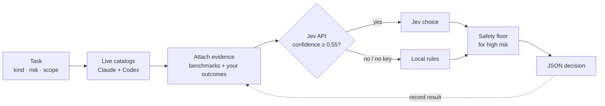

<div align="center">

# 🧭 jev-model-router

**Stop guessing which AI model to use. Route every task to the right Claude or Codex model and reasoning level.**

[English](README.md) · [한국어](README.ko.md) · [日本語](README.ja.md) · [简体中文](README.zh-CN.md)

[](https://www.python.org/)
[](LICENSE)
[](#-quick-start)
[](#-tests)
[](https://platform.claude.com/docs/en/models/overview)
[](https://developers.openai.com/api/docs/models)

</div>

---

Coding agents can delegate work to sub-agents, but *which* model and *how much* reasoning? Picking the biggest model every time burns tokens. Picking the smallest one ships bugs.

**jev-model-router** answers that question in one command. It reads the live model catalogs, weighs official benchmarks and **your own past results**, and prints a single JSON decision your agent can act on.

```bash
python3 jev_model_router.py --task "add unit tests for the parser" --kind code --risk medium
```

```jsonc
// trimmed example output
{
  "provider": "claude",
  "model": "sonnet",
  "effort": "medium",
  "model_source": "jev",
  "model_facts": { "api_model_id": "claude-sonnet-5-5", "api_price": "$2 / input MTok, $10 / output MTok" },
  "evidence": { "basis": "jev_with_evidence", "internal_count": 0 }
}
```

## ✨ Features

- 🔄 **Always current.** Pulls the official Claude model list and the Codex models *your account* can actually use. No hard-coded model table to go stale.
- 🧠 **Model + effort, chosen separately.** Reasoning depth (`low` → `ultra`) is picked on its own merits, not tied to a model brand.
- 📊 **Evidence-based, honestly.** Benchmarks are ranked only when every candidate shares the same test, version and effort. Your own outcomes count only after 5+ comparable results. Missing data means *unknown*, never *bad*.
- 🛡️ **Safety floor.** High-risk tasks never get a model below the required capability or an effort below `high`.
- 🔍 **Cross-provider review.** `--reviewer-of claude` forces a Codex reviewer (and vice versa) for independent checks.
- 📴 **Works offline.** No API key or network failure? Deterministic local rules take over.
- 🔒 **Privacy guard.** Rejects task text that looks like a credential or email address. Outcome files are written with `0600`.
- 📦 **Zero dependencies.** Python standard library only. Two files.

## 🚀 Quick start

```bash
git clone https://github.com/mcpysup-netizen/jev-model-router.git
cd jev-model-router

# Works right away with local rules
python3 jev_model_router.py --task "refactor the auth module" --kind code --risk high --fallback-only

# Optional: enable API-based choice
export TYPESAFE_API_KEY="your-key"
python3 jev_model_router.py --task "refactor the auth module" --kind code --risk high
```

## ⚙️ How it works



The loop is the point: **record how each task went, and the router gets better at your work, not a generic benchmark.**

## 📖 Usage

| Option | What it does |
|---|---|
| `--task` | Short, sanitized summary (max 500 chars) |
| `--kind` | `scan` `mechanical` `writing` `research` `code` `review` `architecture` `coordination` |
| `--risk` | `low` `medium` `high` |
| `--scope` | `small` `medium` `large` (default `medium`) |
| `--priority` | `balanced` `speed` `cost` `quality` (default `balanced`) |
| `--provider` | Limit to `claude` or `codex` |
| `--reviewer-of` | For review, force the *other* provider |
| `--user-model` / `--user-effort` | Your explicit choice always wins |
| `--fallback-only` | Skip the API, use local rules |
| `--list-models` | Show current candidates |

### Close the loop: record outcomes

```bash
python3 jev_model_router.py record --task "parser tests" --kind code --risk medium \
  --scope medium --model claude-sonnet-5-5 --effort medium --verdict pass --minutes 12
```

Verdicts: `pass`, `pass_with_fixes`, `fail`. Optional: `--minutes`, `--cost-usd`, `--rework`, `--note`.

### Refresh benchmarks

```bash
python3 jev_model_router.py refresh-benchmarks
```

## 🔧 Configuration

| Item | Where |
|---|---|
| Jev API key | `TYPESAFE_API_KEY` env, or `~/.config/typesafe/api_key` |
| Data folder | `JEV_DATA_DIR` env, default `~/.local/share/jev-model-router` |
| Catalog cache | `~/.cache/jev-model-router` |
| Several Codex accounts | `~/.config/ai-accounts/accounts.json` ([example](examples/accounts.example.json)), select with `--codex-account` or `AI_CODEX_ACCOUNT` |

## 🤖 Use it from your agent

Add one line to your `CLAUDE.md` or `AGENTS.md`:

```markdown
Before delegating to a sub-agent, run `python3 path/to/jev_model_router.py --task "<one-line summary>" --kind <kind> --risk <risk>`
and pass the returned `model` (and `effort`) to the call.
```

## 🔒 Privacy

- `--task` and `--note` are sent to the API and saved to your local outcomes file. Keep them short and free of secrets.
- Never commit your key, `accounts.json` or outcomes file. `.gitignore` already blocks them.
- Benchmark numbers stay in your local cache. This repository does not redistribute third-party data.

## 🧪 Tests

```bash
python3 -m unittest discover -s tests
```

## ❓ FAQ

**Do I need an API key?** No. Without one, the router uses local rules and still returns a valid choice.

**Why do some messages appear in Korean?** The tool was first built for a Korean workflow. JSON keys are English; some reason strings are Korean.

**Does it call the models themselves?** No. It only decides. Your agent makes the call.

## 📄 License

[MIT](LICENSE)

<div align="center">

If this saves you tokens, a ⭐ helps others find it.

</div>
