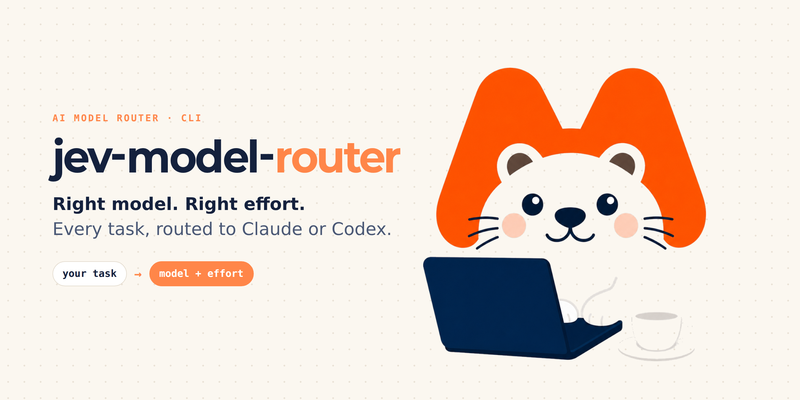
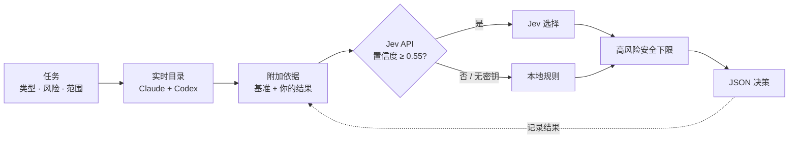

<div align="center">



**别再纠结用哪个 AI 模型。为每个任务自动选择合适的 Claude / Codex 模型和推理等级。**

[English](README.md) · [한국어](README.ko.md) · [日本語](README.ja.md) · [简体中文](README.zh-CN.md)

[](https://www.python.org/)
[](LICENSE)
[](#-快速开始)
[](#-测试)
[](https://platform.claude.com/docs/en/models/overview)
[](https://developers.openai.com/api/docs/models)

</div>

---

编程智能体可以把工作交给子智能体。但该用*哪个*模型？让它思考*多深*？每次都用最大的模型会浪费 token，用最小的模型又容易出 bug。

**jev-model-router** 用一条命令回答这个问题。它读取实时模型列表，综合官方基准测试和**你自己的历史结果**，输出一个智能体可以直接使用的 JSON 决策。

```bash
python3 jev_model_router.py --task "add unit tests for the parser" --kind code --risk medium
```

```jsonc
// 输出示例（已省略部分字段）
{
  "provider": "claude",
  "model": "sonnet",
  "effort": "medium",
  "model_source": "jev",
  "model_facts": { "api_model_id": "claude-sonnet-5-5", "api_price": "$2 / input MTok, $10 / output MTok" },
  "evidence": { "basis": "jev_with_evidence", "internal_count": 0 }
}
```

## ✨ 特性

- 🔄 **始终最新。** 读取官方 Claude 模型列表，以及*你的账号*实际可用的 Codex 模型。没有会过时的硬编码模型表。
- 🧠 **模型与推理等级分开选择。** 推理深度（`low` → `ultra`）按任务决定，不绑定模型品牌。
- 📊 **诚实的依据。** 只有当所有候选模型拥有相同的测试、版本和推理等级时，才用基准分数排序。你自己的结果在有 5 条以上可比记录后才计入。没有数据表示"未知"，而不是"差"。
- 🛡️ **安全下限。** 高风险任务不会分配能力不足的模型，推理等级也不低于 `high`。
- 🔍 **交叉审查。** `--reviewer-of claude` 会强制由 Codex 审查（反之亦然）。
- 📴 **离线可用。** 没有 API 密钥或网络失败时，使用确定性的本地规则。
- 🔒 **隐私保护。** 拒绝看起来像凭据或邮箱地址的任务文本。结果文件以 `0600` 权限写入。
- 📦 **零依赖。** 只用 Python 标准库，两个文件。

## 🚀 快速开始

```bash
git clone https://github.com/mcpysup-netizen/jev-model-router.git
cd jev-model-router

# 使用本地规则，立即可用
python3 jev_model_router.py --task "refactor the auth module" --kind code --risk high --fallback-only

# 可选：启用基于 API 的选择
export TYPESAFE_API_KEY="your-key"
python3 jev_model_router.py --task "refactor the auth module" --kind code --risk high
```

## ⚙️ 工作原理



关键在于这个循环：**记录的结果越多，路由器就越贴合你的工作，而不是通用基准。**

## 📖 用法

| 选项 | 作用 |
|---|---|
| `--task` | 简短且不含敏感信息的任务摘要（最多 500 字符） |
| `--kind` | `scan` `mechanical` `writing` `research` `code` `review` `architecture` `coordination` |
| `--risk` | `low` `medium` `high` |
| `--scope` | `small` `medium` `large`（默认 `medium`） |
| `--priority` | `balanced` `speed` `cost` `quality`（默认 `balanced`） |
| `--provider` | 限定为 `claude` 或 `codex` |
| `--reviewer-of` | 审查任务中强制使用*另一个*提供方 |
| `--user-model` / `--user-effort` | 用户指定始终优先 |
| `--fallback-only` | 跳过 API，只用本地规则 |
| `--list-models` | 显示当前候选 |

### 闭环：记录结果

```bash
python3 jev_model_router.py record --task "parser tests" --kind code --risk medium \
  --scope medium --model claude-sonnet-5-5 --effort medium --verdict pass --minutes 12
```

判定：`pass`、`pass_with_fixes`、`fail`。可选：`--minutes`、`--cost-usd`、`--rework`、`--note`。

### 刷新基准

```bash
python3 jev_model_router.py refresh-benchmarks
```

## 🔧 配置

| 项目 | 位置 |
|---|---|
| Jev API 密钥 | 环境变量 `TYPESAFE_API_KEY` 或 `~/.config/typesafe/api_key` |
| 数据目录 | 环境变量 `JEV_DATA_DIR`，默认 `~/.local/share/jev-model-router` |
| 目录缓存 | `~/.cache/jev-model-router` |
| 多个 Codex 账号 | `~/.config/ai-accounts/accounts.json`（[示例](examples/accounts.example.json)），用 `--codex-account` 或 `AI_CODEX_ACCOUNT` 选择 |

## 🤖 在智能体中使用

在 `CLAUDE.md` 或 `AGENTS.md` 中加一行：

```markdown
委派给子智能体前，运行 `python3 path/to/jev_model_router.py --task "<一行摘要>" --kind <kind> --risk <risk>`，
并把返回的 `model`（和 `effort`）传给调用。
```

## 🔒 隐私

- `--task` 和 `--note` 会发送到 API 并保存在本地结果文件中。请保持简短，不要包含机密。
- 不要提交密钥、`accounts.json` 或结果文件。`.gitignore` 已排除它们。
- 基准数值只保存在本地缓存中。本仓库不再分发第三方数据。

## 🧪 测试

```bash
python3 -m unittest discover -s tests
```

## ❓ 常见问题

**必须有 API 密钥吗？** 不需要。没有密钥时会用本地规则，仍然返回有效结果。

**为什么部分消息是韩语？** 该工具最初为韩语工作流开发。JSON 键是英文。

**它会直接调用模型吗？** 不会。它只负责选择，调用由智能体完成。

## 📄 许可证

[MIT](LICENSE)

<div align="center">

如果它帮你省了 token，点个 ⭐ 让更多人发现它。

</div>
